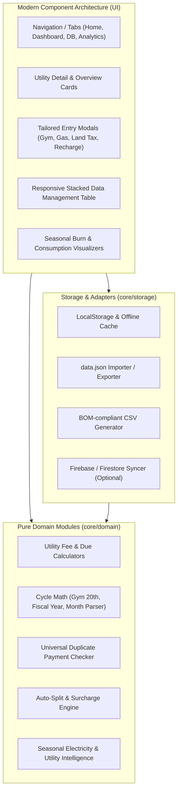

# Billzy: Formal Domain Specification & Invariants Matrix

## 1. Executive Summary & Forensic Audit
This document formally codifies the reverse-engineered domain rules, edge-case fixes, business calculations, and data contracts extracted from the 193 git commits and the 11,839-line legacy implementation of **Billzy** (Dhaka Utility & Subscription Manager).

---

## 2. Business Logic Invariants & Quirks Matrix

| Utility / Domain Area | Billing Type | Cycle & Due Date Math | Late Fee / Surcharge Rules | Auto-Split Eligibility | Specific Invariants & Quirks |
| :--- | :--- | :--- | :--- | :--- | :--- |
| **Rupnagar DESCO** (`rupnagarDesco`) | Prepaid Recharge | • Measured by days since recharge (`now - payDate`)<br>• Burn rate efficiency: `daysPer1k = totalDays / (totalAmt / 1000)`<br>• Daily burn: `totalAmt / totalDays` | Manual fee input supported. | **Eligible** (Remainder `% 100 <= 60` extracted as gateway fee when fee input empty) | • Account `140-10-368`<br>• Seasonal Intelligence: Summer (Mar–Sep, index 2–8) vs Winter (Oct–Feb)<br>• Live API blend: 60% recent daily meter reads + 40% 24-month seasonal history. |
| **Uttara DESCO** (`uttaraDesco`) | Prepaid Recharge | • Same burn rate and days since recharge calculation as Rupnagar DESCO. | Manual fee input supported. | **Eligible** (Remainder `% 100 <= 60` extracted as gateway fee when fee input empty) | • Account `250-38-654`<br>• Same seasonal intelligence and API telemetry format as Rupnagar DESCO. |
| **Rupnagar Gas** (`rupnagarGas`) | Prepaid Recharge | • Days since recharge (`now - payDate`).<br>• Seasonal intelligence extended to gas recharges. | Manual fee input supported. | **Eligible** (Remainder `% 100 <= 60` extracted as gateway fee when fee input empty) | • Account `110-407-082-016`<br>• Prepaid cylinder/card recharge tracking. |
| **Uttara Water** (`uttaraWater`) | Postpaid (DWASA) | • Due date: `paidMonth + 2 months, 1st of month`<br>• Overdue duration formatted in days (e.g. `14d`). | Surcharge / fee manual entry only. | **EXCLUDED** (No auto-splitting allowed, raw amount strictly preserved) | • Account `0901798991`<br>• Month dropdown constrained to 2 earlier paid months.<br>• Commit `505603e` strictly eliminated auto-split. |
| **Noakhali Palli** (`noakhaliPalli`) | Postpaid (BREB) | • Due date: `paidMonth + 2 months, 1st of month`<br>• Overdue duration formatted in days (`{N}d`). | Surcharge / fee manual entry only. | **EXCLUDED** (No auto-splitting allowed) | • Account `103-102-312-7100`<br>• Dual chart order invariant: Monthly Total chart placed above Bill Month vs Pay Date chart (commit `ba1a569`). |
| **Matuail Gas** (`matuailGas`) | Postpaid (Titas Gas) | • Due date: 21st of next month (`paidMonth + 1 month, 21st`).<br>• Multi-month selection (`fromMonth` to `toMonth`). | **Tiered Late Fee**:<br>• Due deadline: 21st of billing month.<br>• If paid > 21st: Overdue.<br>• $\le$ 6 months overdue: 10 Tk / bill.<br>• $>$ 6 months overdue: 20 Tk / bill. | **EXCLUDED** (Fee box is explicit Titas surcharge/delay fine) | • Account `108-26-719`<br>• Default rate: 1080 Tk/mo (`billzy_matuail_rate`).<br>• **Dual-Unit Format**: `${totalDue} (${monthsFraction} M +${fine})` without currency prefix (e.g., `6,580 (6.2 M +100)`).<br>• Overdue duration exclusively in fractional months (`M`). |
| **Inspire Broadband** (`inspireBroadband`) | Prepaid Subscription | • Due date: `paidMonth + 1 month, 1st of month`.<br>• Due date respects billing month instead of `payDate` (commit `bc2d5bc`). | Manual fee entry only. | **EXCLUDED** (Commit `7e79bed` eliminated auto-split) | • Account `rpmehedi6`<br>• Default monthly fee: 840 Tk.<br>• Auto-detection of next unpaid month from payment history. |
| **Gym** (`gym`) | Prepaid Subscription | • **20th-to-20th cycle coverage**: cycle starts on the 20th of the end month of last payment.<br>• Next due date is the 21st (`startCycleDate + duration months, 21st`). | No gateway splitting. | **EXCLUDED** | • Account `1724`, Default 1700 Tk.<br>• Variable lump sum split evenly across duration: `Math.round(total / duration)`.<br>• **Cycle Overlap Logic**: Uses half-open interval `[start, end)` (`s1 < e2 && s2 < e1`) to allow consecutive 20th-to-20th cycles without false duplicates (commit `b1fb76a`).<br>• Subscription pause/lock toggle (`billzy_gym_paused`). |
| **Land Tax** (`landTax`) | Prepaid Municipal Tax | • **Bangladeshi Fiscal Year**: April 1 to March 31.<br>• Formats: `FY YY-YY (Apr 1 - Mar 31)` or `FY YYYY - YYYY`.<br>• Start year auto-derived from property history: if last ended in March $\to$ that year; else `year + 1`.<br>• Due date: April 1st of next fiscal year. | Surcharge field beside amount box. | **EXCLUDED** | • Account `LT-9921`<br>• 3 Bengali properties: `মাতুয়াইল` (1500), `উত্তরখান` (2000), `কেশুরবাগ` (850).<br>• Multi-year range selection (1 to 5 years).<br>• QR code decoder & receipt URL archival (`receiptUrl`, `receiptFileName`, `receiptLocation`). |

---

## 3. Detailed Algorithmic Invariants

### 3.1 Gym 20th-to-20th Cycle & Half-Open Overlap Check
- **Cycle Boundaries**:
  - `startCycleDate`: 20th of the anchor month.
  - `endCycleDate`: `startCycleDate + duration months` on the 20th.
  - `dueDate`: `startCycleDate + duration months` on the 21st.
- **Overlap Formula**:
  Two gym cycles $[s_1, e_1)$ and $[s_2, e_2)$ overlap if and only if:
  $$\text{overlap} = (s_1 < e_2) \land (s_2 < e_1)$$
  *Invariant*: A cycle ending on Oct 20 ($e_1 = \text{Oct 20}$) and a cycle starting on Oct 20 ($s_2 = \text{Oct 20}$) evaluates to `false` (no false duplicate collision), whereas closed interval $[s, e]$ evaluates to `true` (bug fixed in commit `b1fb76a`).

### 3.2 Titas Gas Tiered Late Fee Algorithm
For any range of billing months from $M_{\text{start}}$ to $M_{\text{end}}$, for each month $m$ in the range:
1. `dueDeadline` = `21st of month m at 23:59:59.999`.
2. If `paymentDate > dueDeadline`:
   - `sixMonthsPastDue` = `21st of (month m + 6 months) at 23:59:59.999`.
   - If `paymentDate > sixMonthsPastDue`: fee $= 20\text{ BDT}$.
   - Else: fee $= 10\text{ BDT}$.
3. Else: fee $= 0\text{ BDT}$.
$$\text{Total Fee} = \sum_{m} \text{fee}(m)$$

### 3.3 Matuail Gas Dual-Unit & Overdue Duration
- Elapsed days from start of first unpaid month:
  $$\text{diffDays} = \max\left(0, \left\lfloor \frac{\text{today} - \text{nextUnpaidStart}}{86400000} \right\rfloor + 1\right)$$
- Fractional months:
  $$\text{monthsFraction} = \max\left(0.1, \text{round}\left(\frac{\text{diffDays}}{30.4375} \times 10\right) / 10\right)$$
- Display format:
  $$\text{dueText} = \text{totalDue.toLocaleString()} + \text{ " ("} + \text{monthsFraction} + \text{" M"} + (\text{fine} > 0 ? \text{" +" + fine} : \text{""}) + \text{")"}$$

### 3.4 Billing Month Dropdown Window
- Given anchor date $D_{\text{anchor}}$ (defaulting to the next unpaid month or payment month):
  - Prior months: strictly 2 earlier months ($[-2, -1]$).
  - Current month: $[0]$.
  - Future projection: up to 12 months ($[+1, \dots, +12]$).
- Dropdown labels: `Month YYYY` (e.g. `July 2026`). If already recorded, append `(Paid)`.

### 3.5 Duplicate Entry Prevention Rules
`checkDuplicatePayment(billId, monthVal, extra, excludeUid)`:
1. **Gym**: check `doGymCyclesOverlap(newCycle, existingCycle)`.
2. **Matuail Gas**: check `doMonthRangesOverlap(newRange, existingRange)`.
3. **Land Tax**: check `isLandTaxFYMatch(newFY, existingFY)` constrained to the same `property` (or where existing is `সকল ৩টি সম্পত্তি`).
4. **General Utilities**: check `isBillingMonthMatch(newMonth, existingMonth)`.
5. Exclude current record if `uid === excludeUid` during modal edit.

### 3.6 Surcharge / Fee Auto-Splitting
- Eligible utilities: `['rupnagarDesco', 'uttaraDesco', 'rupnagarGas']`.
- Condition: `fee === 0 && amount > 100 && (amount % 100) > 0 && (amount % 100) <= 60`.
- Split logic: `fee = amount % 100`, `baseAmount = amount - fee`.
- Non-eligible utilities (`inspireBroadband`, `matuailGas`, `noakhaliPalli`, `uttaraWater`, `gym`, `landTax`): `fee = 0`, `baseAmount = amount`.

---

## 4. Formal Data Contracts & Schemas

### 4.1 Payment Record (Canonical Schema)
```typescript
export interface PaymentRecord {
  uid: string;                    // Pattern: /^mr[a-z0-9]+$/
  billId: string;                 // Enum: rupnagarDesco | uttaraDesco | rupnagarGas | uttaraWater | matuailGas | noakhaliPalli | inspireBroadband | gym | landTax
  billName: string;               // Display title, e.g. "Rupnagar DESCO"
  billType: 'prepaid' | 'postpaid';
  utilityCategory?: 'electric' | 'gas' | 'water' | 'internet' | 'gym' | 'tax';
  billMonth: string;              // Single month, range, or FY string (empty for prepaid recharges)
  amount: string;                 // Base amount string as stored in legacy data.json
  amountNum?: number;             // Base numeric amount
  fee?: string;                   // Fee amount string
  feeNum?: number;                // Fee numeric amount
  totalPaid?: number;             // amountNum + feeNum
  payDate: string;                // ISO Date: YYYY-MM-DD
  savedAt: string;                // ISO 8601 Timestamp: YYYY-MM-DDTHH:mm:ss.sssZ
  timestamp?: number;             // Epoch milliseconds
  property?: string;              // Land tax property in Bengali (e.g. মাতুয়াইল, উত্তরখান, কেশুরবাগ)
  receiptUrl?: string;            // HTTPS link to payment receipt / voucher
  receiptFileName?: string;       // Archived receipt file name
  receiptLocation?: string;       // Storage path / drawer location
  note?: string;                  // User notes or shortcut tag
}
```

### 4.2 LocalStorage Model Contracts
- `billzy_firestore_cache`: `PaymentRecord[]` (JSON stringified).
- `billzy_local_payments`: `PaymentRecord[]` (JSON stringified local unsynced records).
- `billzy_matuail_rate`: `number` as string (default `'1080'`).
- `billzy_gym_paused`: `'true' | 'false'` (default `'false'`).
- `billzy_landtax_rate_matuail`: `number` as string (default `'1500'`).
- `billzy_landtax_rate_uttarkhan`: `number` as string (default `'2000'`).
- `billzy_landtax_rate_keshurbag`: `number` as string (default `'850'`).

### 4.3 CSV Export Contract
- **Encoding**: UTF-8 with BOM (`\uFEFF`).
- **Headers**:
  `Transaction ID,Date Paid,Utility Name,Category,Account / Meter No,Billing Type,Billing Month,Main Amount (BDT),Fee (BDT),Total Paid (BDT),Property / Note,Receipt Link / File,Created At (UTC)`
- **Sorting**: Newest `payDate` first (`descending`).

---

## 5. Architectural Blueprint



---
*Specification generated and verified against 193 git commits of the Billzy repository.*
